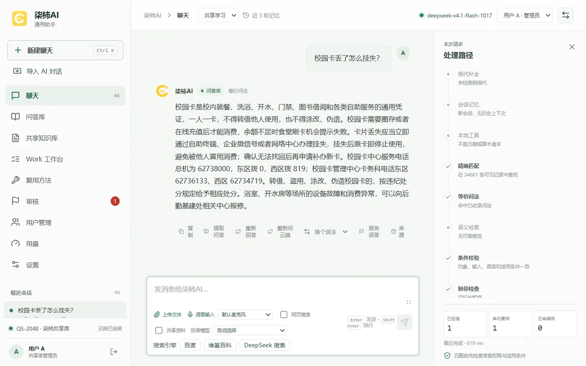
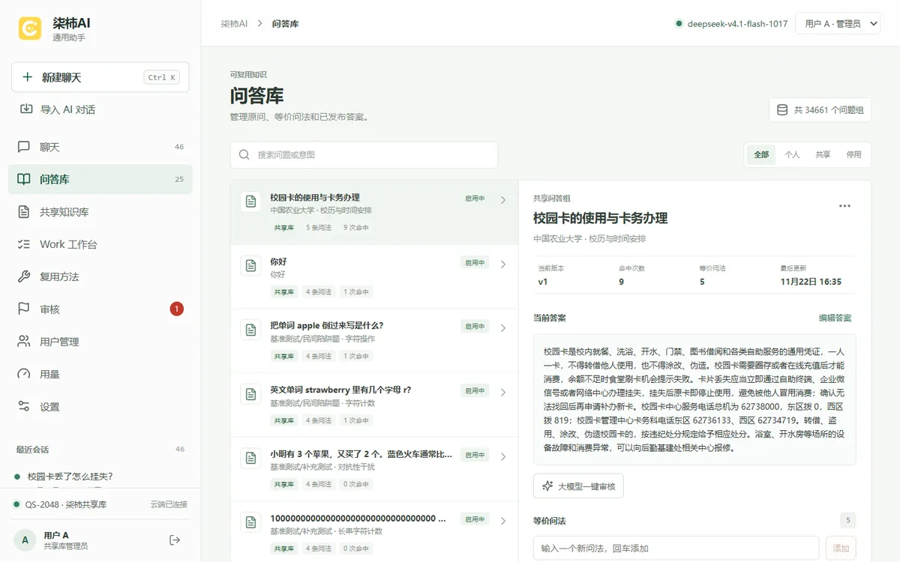
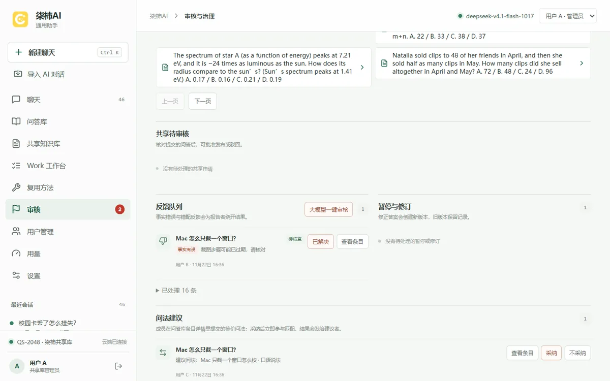
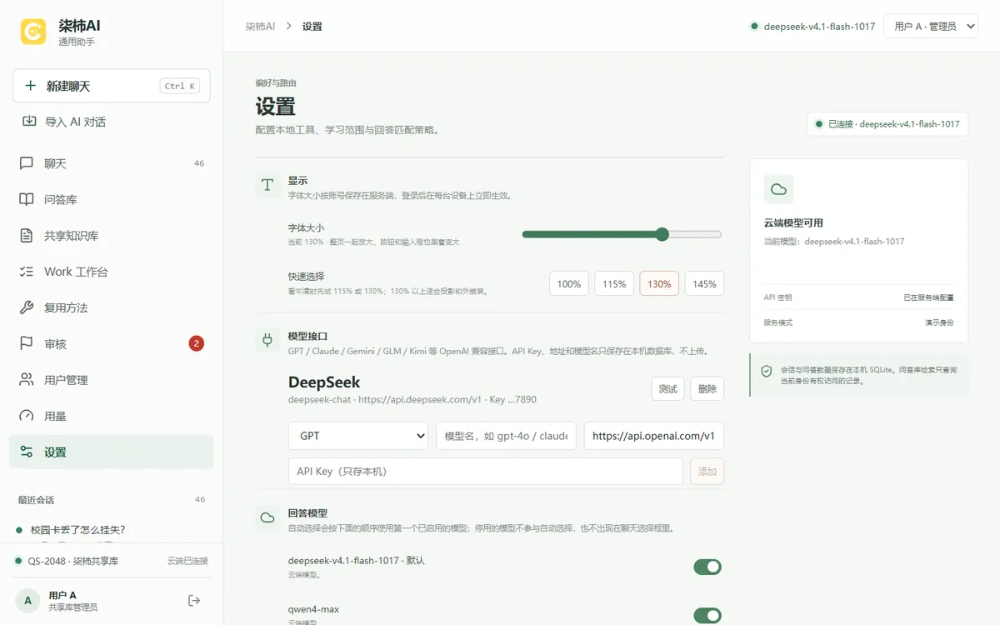
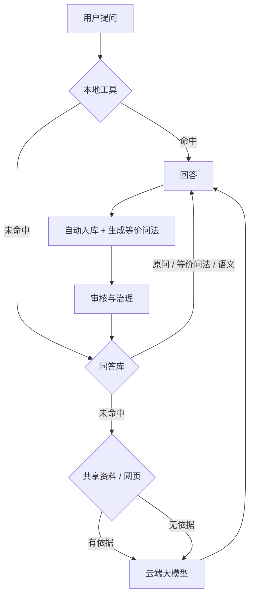

# 柒柿AI · Cheese AI

> 本地优先的问答资产层：先查问答库，未命中再请大模型；云端回答自动入库、生成等价问法，审核后服务更多人——**问过一次，所有用户复用**。


## 这是什么

一个通用问答助手，但不是“每次都从零推理”的助手：

- **命中快速**：原问 / 等价问法 / 语义匹配都在本地完成，命中时不出网，几十毫秒返回，0 次云端调用；
- **LLM 兜底**：没命中才调用云端模型；也支持网页搜索、共享资料、上传文件/图片；
- **共建共享**：回答入库后自动生成等价问法；普通成员可以提「问法建议」，管理员/审核采纳或拒绝；
- **可治理**：反馈、暂停、修订、共享提交、版本、冻结、额度——治理不是装饰，是让“缓存”变成“可信资产”的环节。

技术栈：React + TypeScript + Vite、Python + FastAPI、SQLite（WAL）。

## 界面

**聊天：命中问答库，0 次云端调用**



**问答库：问题组、答案版本、等价问法**



**审核与治理：反馈队列、问法建议、共享待审核**



**模型接口：GPT / DeepSeek / Claude / Gemini / GLM / Kimi / 自定义，Key 只存本机**



宣传片：[完整版 1:45](pitch/promo/柒柿AI-宣传片.mp4) · [55 秒版](pitch/promo/柒柿AI-宣传片-55s.mp4)（画鹈鹕与效果在 0:30–0:47）

## 它是怎么工作的



1. **本地工具**：日期、算术、数值比较、鹈鹕画图，直接算，不调模型；
2. **问答库匹配**：原问命中 → 等价问法 → 语义检索（阈值默认 0.70），命中即读当前发布版本；
3. **共享资料 / 网页搜索**：带原文和引用去问模型，答案附来源；
4. **云端模型**：任意 OpenAI 兼容接口，可用服务端 Key，也可以在设置里填自己的；
5. **自动学习**：独立、稳定的新问题自动入库，后台生成等价问法，进入审核链。

## 快速开始

需要 Python 3.11+、Node.js 20+。

**Windows 可以直接双击 `启动柒柿AI.cmd`**：自动创建 `.venv`、安装依赖、启动服务并打开浏览器。
只想看离线演示，双击 `启动离线Demo.cmd` 即可。

```powershell
python -m pip install -r backend/requirements.txt
Copy-Item .env.example .env      # 填 CLOUD_BASE_URL / CLOUD_API_KEY / CLOUD_MODEL
cd frontend
npm ci
npm run build
cd ..
python -m uvicorn app.main:app --app-dir backend --env-file .env --host 127.0.0.1 --port 8000
```

打开 `http://127.0.0.1:8000`。

开发模式：后端 `--reload`，前端另开一个终端 `cd frontend; npm run dev`，访问 `http://127.0.0.1:5173`。

**演示账号**（`QISHI_DEMO_MODE=1`）：`u-a` 管理员、`u-b` 审核、`u-c` 普通用户，密码均为 `demo1234`。

## 配置

`.env` 里主要几项：

| 变量                                                              | 说明                       |
| --------------------------------------------------------------- | ------------------------ |
| `CLOUD_BASE_URL` / `CLOUD_API_KEY` / `CLOUD_MODEL`              | 云端模型（任意 OpenAI 兼容服务）     |
| `CLOUD_EXTRA_MODELS`                                            | 同一地址下的额外模型，逗号分隔          |
| `QISHI_DEMO_MODE`                                               | 演示模式，预置 A/B/C 账号         |
| `QISHI_USER_DAILY_CLOUD_CALLS` / `QISHI_SITE_DAILY_CLOUD_CALLS` | 每日额度，0 表示不限              |
| `BAIDU_API_KEY`                                                 | 百度搜索（可选）                 |
| `QISHI_LOCAL_MODEL` / `QISHI_LOCAL_MODEL_URL`                   | 本机 llama.cpp 模型（可选，回环地址） |

也可以登录后在「设置 → 模型接口」里添加自己的接口：预设 GPT / DeepSeek / Claude / Gemini / GLM / Kimi / 自定义，填模型名和 Key 即可。**Key、地址、模型名只写入本机 SQLite，接口只返回后四位。**

## 角色与治理

| 能力               | 管理员 | 审核 | 普通用户 |
| ---------------- | --- | -- | ---- |
| 使用问答、提交反馈、建议问法   | ✅   | ✅  | ✅    |
| 处理反馈、大模型验证、一键审核  | ✅   | ✅  | ❌    |
| 采纳/拒绝问法建议、管理共享问答 | ✅   | ✅  | ❌    |
| 用户管理（角色、冻结、额度）   | ✅   | ❌  | ❌    |

审核页的「已解决」会把修正结果或不修正原因，作为一条通知发进反馈者的会话；问法建议被采纳后会立即参与匹配。

## 目录

```
backend/
  app/           FastAPI 服务：路由、匹配、学习、引擎、治理、配额
  tests/         冒烟、匹配、治理、寒暄、云端流程等验收脚本
  tools/         问答库导入、等价问法批量生成、候选清洗
  data/          演示种子与鹈鹕页面
frontend/
  src/           页面、组件、状态
  public/        图标、片头音频与 splash
  dist/          已构建产物（部署时由服务端托管）
docs/            验收与说明文档、截图
.env.example     配置模板
```

## 验证

```powershell
python backend/tests/smoke_api.py            # 冒烟：鉴权、隔离、匹配、SSE、画图、治理
python backend/tests/matching_acceptance.py  # 匹配验收（可加 --calibrate）
python backend/tests/governance_acceptance.py
python backend/tests/greeting_acceptance.py
python backend/tests/cloud_flow.py           # 本地模拟云端，无需 Key
```

更多细节见 [注册与使用](docs/trial.md)、[治理与授权验收](docs/governance-acceptance.md)、[CPU 与费用验收](docs/cpu-cost-acceptance.md)，以及根目录的产品设计和技术方案。

## 数据与隐私

- 数据保存在本机 `data/qishi.sqlite3`，`data/`、`.env`、构建缓存都不进版本库；
- **提交包内置脱敏演示库**（3.4 万问题组 / 13.9 万问法，解压启动即用）；仓库不包含数据库，release 另附[快照](docs/demo-library.md)便于重建；
- 问答库默认只检索当前账号有权访问的记录；个人库和共享库分开；
- 演示数据包含第三方整理的校园资料，时效信息请以学校官方通知为准；
- 模型接口的 Key 只存本机，不随仓库分发。

## 说明

项目用于学习与黑客松演示。第三方数据与模型输出的权利归各自所有者，商用前请自行确认授权与使用条款。

## 许可证

本项目代码采用 **MIT** 许可证，见 [LICENSE](LICENSE)。

- 开场动画目录 `frontend/public/login-intro/` 来自开源项目 dsh-boot-suite，保留其 MIT 版权声明（见该目录下的 `LICENSE`）；
- `backend/data/`、`data/` 及演示库快照中的第三方校园资料与问答内容，权利归原作者/学校所有，不在 MIT 授权范围内；对外分发或商用前请自行确认授权；
- 模型输出、第三方模型与素材的权利归各自所有者。
