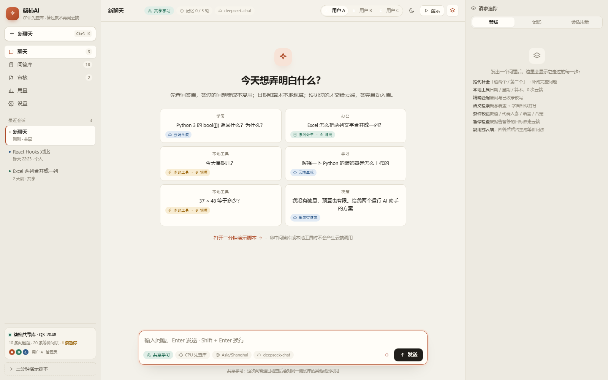
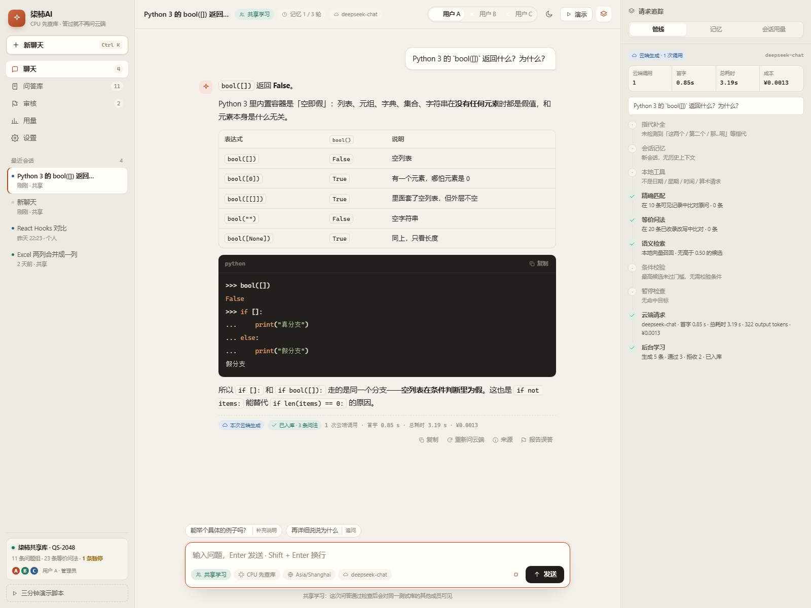
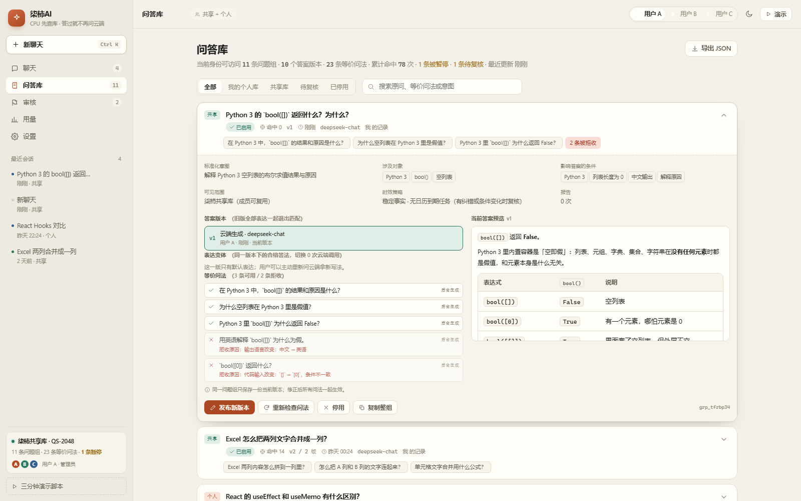
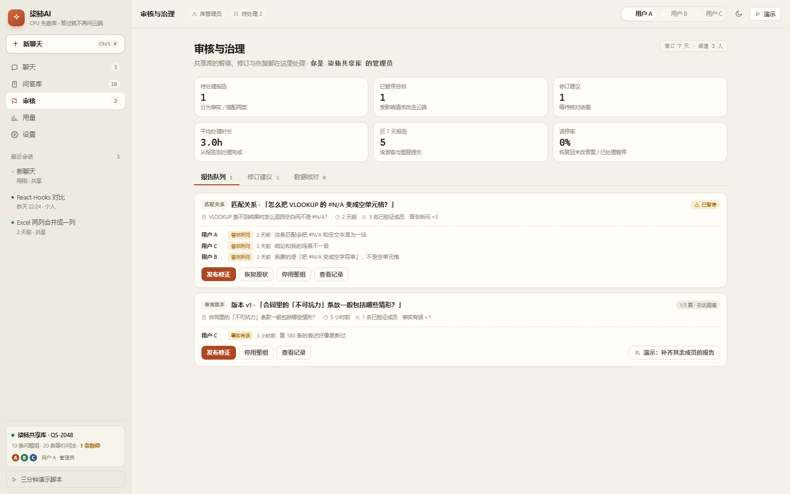
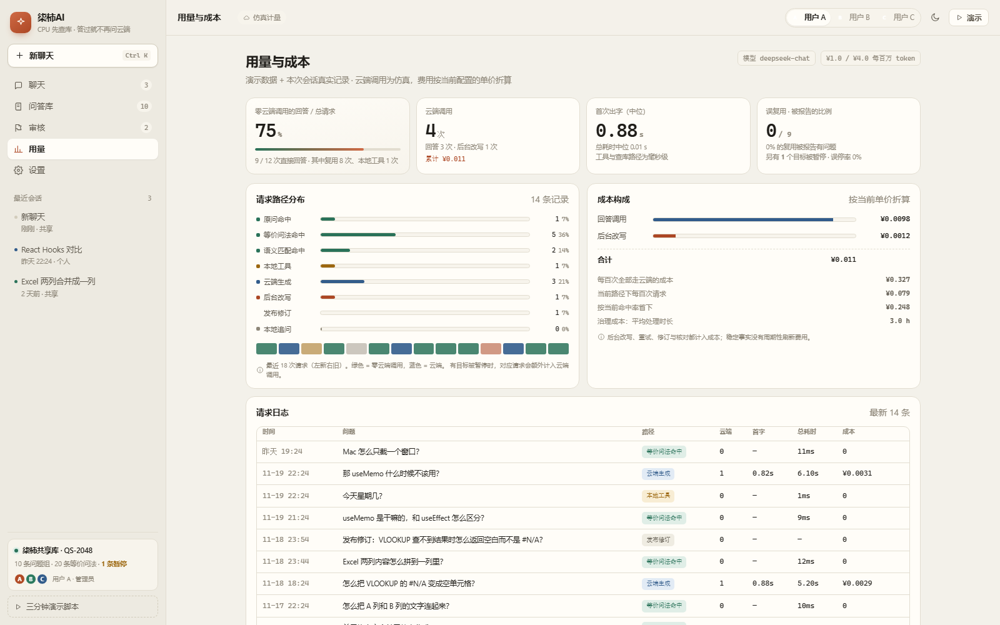
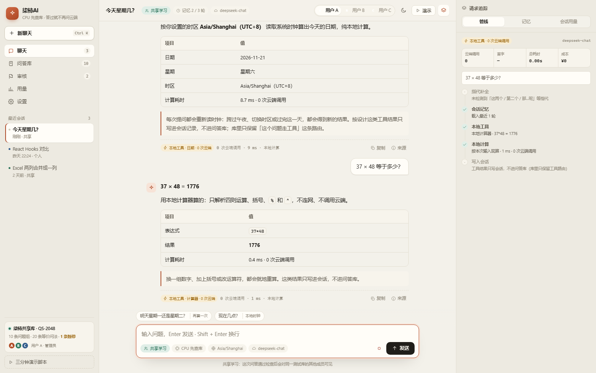

# 柒柿AI · 纯前端交互演示（v1.1）

> 原「神秘 Bot」，现更名 **柒柿AI**。产品文档里的功能与验收标准不变；界面、共享库（QS-2048）、存储键（`qishi-ai.v1`）都已同步，旧版本存下的演示数据会在首次打开时自动迁移。

把《黑客松产品设计》里最核心的那条链路做成一个可以直接点、直接看的网页：

**先查本地问答库 → 没命中才问云端 → 答完自动生成等价问法入库 → 换个说法再问，零云端调用；日期与算术本地现算；答案有版本、有表达变体、有报告与审核。**

没有后端、没有构建、没有任何依赖：双击 `index.html` 就能用。数据是假数据，存在浏览器里。





---

## 与技术方案的关系

团队的技术方案是 **React + TypeScript + Vite / FastAPI / SQLite / BGE 向量**。这个 demo 是同一套交互的**无后端原型**，刻意做成零依赖单页，方便在任何一台电脑上双击演示：

| 技术方案里的模块 | 这个 demo 里对应的东西 |
| --- | --- |
| React 页面（聊天 / 问答库 / 管理） | `assets/js/views/*.js`，按同样的组件边界拆的五个页面 |
| FastAPI + SSE 流式回答 | `assets/js/cloud.js` 的仿真流式（首字延迟、逐段吐字、token 计量） |
| SQLite 会话 / 问答组 / 版本 / 报告 | `assets/js/store.js` 的内存状态 + localStorage 快照 |
| 本地匹配（BGE + 句对模型） | `assets/js/matcher.js` 的概念覆盖打分 + 规则条件校验 |
| 本地工具（日期、星期、算术） | `assets/js/tools.js`，真的按时区读系统时钟、真的算表达式 |
| `current_user` + 库成员权限 | `App.store.isAdmin()` / `visibleRecords()` + 右上角三个身份 |
| 报告 → 7 天窗口 → 3 票暂停 | `App.store.addReport()` / `votesFor()` / `Suspension` |

要接到真实后端时，接口契约见 **[docs/API-CONTRACT.md](docs/API-CONTRACT.md)**：里面写了 REST 端点、SSE 事件、数据表字段和权限检查点，按着换掉三个模块（`cloud.js` → fetch、`store.js` → API 客户端、`matcher.js` → 服务端匹配）就能跑。

---

## 快速开始

1. 双击 `index.html`（推荐 Edge / Chrome）。
2. 右上角点 **演示**，按顺序点 11 个步骤的「执行」，三分钟走完：学习闭环 → 本地工具 → 追问 → 表达变体 → 报告 → 暂停 → 修正 → 版本发布。
3. 想从头再来：设置 → 「重置演示数据」。

> 用 `file://` 直接打开即可，localStorage 同样有效；换台电脑想共享数据就起个静态服务器（`python -m http.server 8080`）。

---

## 三分钟演示脚本（和产品文档的演示一一对应）

| # | 动作 | 应该看到什么 |
| --- | --- | --- |
| 1 | A 问「Python 3 的 `bool([])` 返回什么？为什么？」 | 云端流式回答；追踪面板显示「精确 0 条 → 语义无候选 → 云端生成」；答完自动入库、后台生成等价问法 |
| 2 | 打开 **问答库** | 新问题组：v1 版本、3 条问法通过 / 2 条拒收、3 个表达变体 |
| 3 | 切到 **用户 B**，用已收录的改写提问 | 命中「等价问法」→ 0 次云端调用，读 v1 |
| 4 | B 换一个从未收录的说法（`if` 条件问法） | 语义匹配 0.84 通过条件校验 → 仍是 0 次调用，真实问法自动入组 |
| 5 | B 把输入改成「那 `bool([0])` 呢？」 | 相似度 0.89，但**代码入参变了** → 条件校验不通过 → 重新问云端 |
| 6 | A 问「今天星期几？」「37 × 48 等于多少？」 | **本地工具**按时区读时钟、就地算算术：0 次云端调用，结果只写会话 |
| 7 | A 要两个方案 →「这两个哪个好？」→「第二个呢？」 | 生成类请求走云端；追问补全指代并沿用「预算有限、没有独显」 |
| 8 | B 点回答下方的「换个说法」 | 切到「简短表达」，同一版本的合格答法，0 次云端调用 |
| 9 | B 对一条命中报告「答非所问」 | 报告绑定到「这条匹配关系」；从第一条起 B 自己会绕开它，票数 1/3 |
| 10 | A 打开 **审核** → 补齐票数 → 发布修正 | 7 天内 3 名不同成员才暂停；修正发布后自动恢复，旧版退出匹配 |
| 11 | A 对 Excel 那条「重新问云端」→ 发布为新版本 | 问题组出现 v3，旧版全部表达退出匹配，历史聊天保留当时的答复 |

---

## 页面与功能

### 聊天页
- 左侧会话列表（标题 / 时间 / 共享或个人 / 最后一条回答的来源点）。
- 中间流式回答、Markdown（标题、列表、表格、代码块 + 复制）。
- 每条回答底部的操作条随来源变化：

| 来源 | 操作 |
| --- | --- |
| 问答库 | 复制 / **换个说法** / 查看来源 / 重新问云端 / 报告误答 |
| 本地工具 | 复制 / 来源（显示计算方式、时区、耗时） |
| 云端 | 复制 / 重新问云端 / 来源；若是「重新问云端」还会出现 **采用为新版本**（个人库）或 **发布为新版本 / 建议修订**（共享库）与 **保留原版** |
| 待核对 | 去核对（模拟）/ 查看来源 / 直接问云端 |
| 失败 | 重试 |

- 右侧 **请求追踪**：指代补全 → 会话记忆 → **本地工具** → 精确匹配 → 等价问法 → 语义检索（分数拆成概念覆盖 / 字面相似）→ 条件校验 → **暂停检查** → **时效检查** → 复用 / 云端 → 学习；另有「记忆」「会话用量」两页。



### 问答库页
- 每条问题组：原问、范围、状态（启用 / 生成中 / 待复核 / 已暂停 / 停用 / 待核对）、命中次数、当前版本、更新时间。
- 展开后：标准化意图 / 对象 / 条件 / 时效策略 / 报告次数，**答案版本时间线**（谁发布、依据、可回滚），**表达变体**，等价问法逐条状态（通过 / 拒收原因 / 被暂停），当前答案预览。
- 操作：发布新版本（旧版全部表达退出匹配）、重新检查问法、停用 / 启用、复制整组、导出 JSON；工具路由记录单独显示「每次现算，不入库」。



### 审核与治理页（新增）
- 六个指标：待处理报告、已暂停目标、修订建议、**平均处理时长**、近 7 天报告、**误停率**。
- **报告队列**：按「匹配关系」或「答案版本」聚合，显示报告人、类别（事实有误 / 答非所问 / 表达不合适）、备注、票数（n/3）；管理员可 **发布修正 / 恢复原状 / 停用整组**，并可跳转查看记录。
- **修订建议**：并排对比「当前答案」与「建议答案」，可发布为新版本、收为表达变体、保留原版。
- **数据核对**：按来源版本管理「会变的资料」，显示上次核对 / 复核间隔 / 是否过期，可发起核对；同一来源版本同时只允许一个在途任务。
- 权限：B / C 进入是只读（提示「只有共享库管理员可以发布或停用」）。



### 用量与成本页
- 零云端调用的回答 / 总请求（拆出复用次数与本地工具次数）、云端调用（回答 / 后台改写分开）、首字与总耗时中位、误复用比例与暂停数。
- 路径分布（含 **本地工具** 与 **发布修订**）、成本构成、每百次请求成本、平均处理时长、完整请求日志。

### 设置页
- 身份与权限（当前角色、共享库、管理员）。
- **时区**（影响「今天星期几」）与工具试用按钮。
- 云端模型、单价、云端连接开关（关掉后：已收录问答与工具照常，未命中显示重试入口）。
- 语义门槛滑块、上下文轮数、**匹配调试**（会跑暂停与绕开规则）。
- 自动学习、新会话默认范围、生成问法数、**暂停阈值**、**观察窗口**、记录有效期。

---

## 关键机制

### 1. 本地工具（0 次云端调用）
`tools.js` 识别三类请求并按**输入现算**：

- **日期 / 星期 / 时间**：按设置里的 IANA 时区读系统时钟（「今天星期几」「2026-11-20 是星期几」「现在几点」），跨午夜或切换时区都取到新结果。
- **算术**：自己写的递归下降求值器，支持 `+ - * / % ^` 与括号，不 `eval`。



工具结果只写会话记录**不入库**；问答库里只保留「这个问题走工具」的路由（演示里有两块：日期路由、算术路由）。

### 2. 匹配（和上一版一致，多了两层闸门）
`score = 0.85 × 概念覆盖 + 0.15 × 字面相似`，过门槛后再做六类条件校验（代码入参 / 数值 / 输出语言 / 互斥对象 / 否定 / 其他），全部通过才复用。新增两道闸门：

- **暂停检查**：目标（某个版本 / 某条匹配关系）被暂停 → 直接走云端，并在追踪里写明原因。
- **报告人绕开**：你报告过「事实有误」或「答非所问」的对象，之后你自己的请求自动绕开它（从第一条报告起生效）。

### 3. 版本与表达变体
- 每个问题组有多个**答案版本**（v1、v2…），只有当前版本参与匹配；发布新版本时旧版**全部表达一起退出匹配**。
- 同一版本下可以挂多个**表达变体**（简短 / 详细 / 举例），切换只换文字，`0` 次云端调用，结论与适用条件必须一致。
- 库里没有想要的风格时，用户可以「重新问云端」；个人库所有者可「采用为新版本」，共享库成员只能「建议修订」。

### 4. 报告 → 暂停 → 修正
- 报告分三类：**事实有误**（指向版本）、**答非所问**（指向匹配关系）、**表达不合适**（只影响自己的说法，不计票）。
- 从第一条报告起，报告人自己绕开该对象；共享库在滚动 **7 天**内被 **3 名不同已验证成员** 报告同一对象才临时暂停（重复提交只算 1 人，阈值和窗口在设置里可调）。
- 暂停后受影响请求交给云端；管理员可恢复（计入误停率）、发布修正（自动恢复）、停用整组，并可按版本回滚。
- 「重新问云端」不计误答票。

### 5. 时效策略
- 稳定事实（如空列表布尔值）：无日历到期任务，有纠错或条件变化时才复核。
- 会变的资料（如软件价格）：按**来源版本**建键，记录复核间隔；到期不主动刷新，等下一次有人问再核对，同一来源版本只允许一个在途任务；缺可验证来源时提示**暂无法确认当前值**。
- 工具算出的日期 / 星期 / 时间 / 算术：每次现算，只写会话。

---

## 真与假的边界

| 部分 | 真实程度 |
| --- | --- |
| 匹配引擎、条件校验、暂停与绕开、版本选择、变体切换 | **真实实现** |
| 日期 / 星期 / 时间 / 算术工具 | **真实计算**（按时区、按表达式） |
| 问答库、会话、版本、报告、修订、用量 | **真实实现**，存 localStorage |
| 云端回答 | 本地模板 + 仿真流式（首字 0.6–1.1s、逐字流式、token 与费用按字数估算），没有网络请求 |
| 后台生成等价问法 | 模板生成 + 真实条件检查，2.6–4.2s 仿真耗时 |
| 报告窗口 / 暂停票数 | **真实计算**（按报告记录、去重、窗口过滤）；「演示：补齐其余成员的报告」是明确的演示按钮 |
| 用量与成本 | 按设置里的单价折算，token 是估算值 |

---

## 交互与快捷键

- `Enter` 发送，`Shift + Enter` 换行。
- `Ctrl / Cmd + K` 新建聊天，`Ctrl / Cmd + /` 打开演示脚本。
- 右上角 `用户 A / B / C` 切换身份：**A 是共享库管理员**，B / C 是普通成员。个人库的记录只有本人可见；共享库按成员关系放行；只有管理员能发布 / 停用 / 恢复。
- 右上角月亮 / 太阳切换深色主题。

---

## 文件结构

```
启动演示.bat                双击即可用默认浏览器打开
index.html                 入口（普通 <script> 引入，file:// 下可直接打开）
assets/css/app.css         设计系统与全部样式（含深色主题）
assets/js/
  utils.js                 图标、toast、浮层菜单、模态框、存储降级、时间格式
  markdown.js              迷你 Markdown（表格 / 代码高亮 / 列表嵌套 / 流式稳定化）
  seed.js                  假数据：10 个问题组（含 2 条工具路由）、报告、修订、暂停、会话、用量
  store.js                 状态、权限、版本与变体、报告与暂停、修订发布、持久化
  matcher.js               概念打分 + 条件校验 + 暂停/绕开挂钩
  tools.js                 本地工具：日期 / 星期 / 时间 / 四则运算
  cloud.js                 云端模板、流式仿真、改写生成与校验
  engine.js                请求管线（工具 → 匹配 → 暂停 → 时效 → 复用/云端 → 学习）
  inspector.js             右侧追踪面板
  demo.js                  11 步演示脚本
  app.js                   外壳、路由（聊天 / 问答库 / 审核 / 用量 / 设置）、身份切换、主题
  views/chat.js            聊天页
  views/library.js         问答库页（版本 / 变体 / 暂停）
  views/governance.js      审核与治理页
  views/usage.js           用量页
  views/settings.js        设置页
screenshots/               成品截图（README 里引用）
docs/API-CONTRACT.md       接真实后端时的接口契约
```

---

## 已知限制

- 语义相似度是「概念表 + 字面 bigram」，不是真的向量模型；换成 BGE 只需替换 `matcher.js` 的 `scoreRecord`。
- 云端回答是有限模板，覆盖了演示里的几个话题；别的问题会走通用模板（结构清楚，但不是真的在回答）。
- 账号体系、多设备同步、游客反馈队列、并发修订冲突检测只做了数据模型和提示，没有真实的服务端并发控制。
- 布局按 ≥1280px 宽设计；窄屏会自动隐藏右侧追踪面板和侧栏。

---

## 和产品文档的对应关系

| 产品文档能力 | 在 demo 里看哪里 |
| --- | --- |
| 日常聊天 / 流式 / Markdown / 复制 / 重试 | 聊天页与每条回答的操作条 |
| 会话内记忆 / 「这两个」「第二个」 | 追问后追踪面板的「补全后的问题」、记忆标签页 |
| 本地工具（日期、星期、算术） | 问「今天星期几」「37 × 48」，追踪里出现「本地工具」，0 次云端 |
| 按意图复用已知答案 | 追踪面板的管线 + 候选分数 + 条件校验 |
| 新问题问云端 / 重新问云端 | 回答底部「重新问云端」、设置里的云端开关 |
| 回答后自动学习 | 「后台生成等价问法 → 已入库」、问答库里的拒收原因 |
| 答案版本 / 表达变体 / 换个说法 | 问答库的版本时间线、聊天里的「换个说法」 |
| 个人与共享问答库、库管理员 | 右上角 A / B / C、问答库与审核页的权限提示 |
| 报告误答 / 7 天窗口 / 3 票暂停 | 报告弹窗（三类 + 票数）、审核页报告队列 |
| 修正、恢复、停用、回滚 | 审核页「发布修正 / 恢复原状 / 停用整组」、问答库版本「回滚到此版」 |
| 时效与来源版本 | 问「Figma 团队版多少钱一个月」→ 暂无法确认 + 去核对；审核页「数据核对」 |
| 回答来源和纠错 | 「查看来源」弹窗、「报告误答」 |
| 云端用量与成本 | 用量页（含工具路径、误停率、处理时长） |
