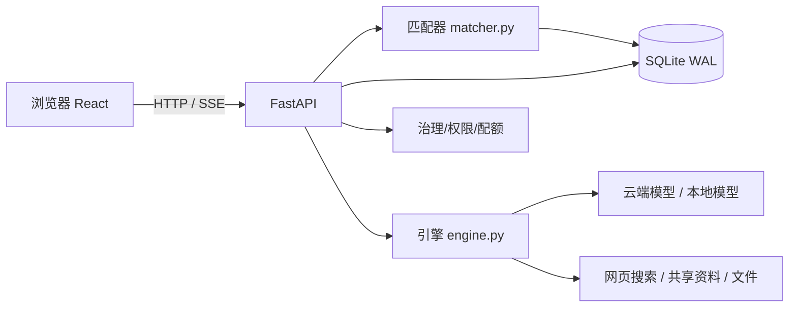

# 柒柿AI · 技术说明（technical notes）

本文档描述当前实现的技术结构、关键算法、数据模型、接口与已知限制，面向想读代码或二次开发的人。产品向的介绍见 [README](README.md)。

## 1. 概览

- 目标：把「云端回答过的问题」沉淀成可复用的本地问答资产；命中不出网，未命中才调用大模型。
- 形态：单机 Web 应用。浏览器 → FastAPI（同源托管前端与 API）→ SQLite（WAL）。
- 技术栈：React 18 + TypeScript + Vite；Python 3.11+、FastAPI、SQLite；SSE 流式输出。
- 目录：`backend/app/` 服务，`backend/tools/` 导入与生成工具，`backend/tests/` 验收脚本，`frontend/src/` 页面。

## 2. 架构



- 单进程即可运行：`uvicorn app.main:app --app-dir backend`，`frontend/dist` 由服务端同源托管。
- 没有消息队列、没有向量数据库；学习任务在请求返回后由后台协程执行，失败写入 `learn_tasks`。
- 数据库迁移在启动时 `initialize()`：建表 + `PRAGMA table_info` 检查后 `ALTER TABLE` 补列，幂等。

## 3. 数据模型（SQLite）

| 表 | 作用 | 关键字段 |
| --- | --- | --- |
| `users` | 账号 | `role`（admin/reviewer/member）、`daily_cloud_calls`、`frozen`、`password_hash` |
| `auth_sessions` | 登录会话 | `user_id`、`expires_at`、`revoked` |
| `libraries` / `library_members` | 共享库与成员角色 | `library_id='QS-2048'`、`role`（admin/member） |
| `groups` | 问题组 | `owner_id`、`scope`（personal/shared）、`original`、`current_version_id`、`status`、`source`、`review_at` |
| `group_versions` | 答案版本 | `n`、`answer`、`basis`、`status`（published/superseded） |
| `aliases` | 等价问法 | `text`、`text_key`（归一化）、`source`（original/seed/generated/observed/manual）、`status` |
| `variants` | 「换个说法」的表达版本 | `version_id`、`style`、`content` |
| `sessions` / `messages` | 聊天会话与消息 | `scope`、`meta_json`（query、trace、来源、命中信息） |
| `learn_tasks` | 后台学习任务 | `state`（queued/running/done/failed）、`attempts`、`last_error` |
| `reports` / `answer_reports` | 反馈（组级 / 消息级） | `status`、`resolution`、`reply`、`handled_by` |
| `suspensions` | 暂停对象 | `kind`（version/match）、`status`、`since`、`reason` |
| `revisions` | 成员修订建议 | `proposed_answer`、`status`、`source_message_id` |
| `shared_submissions` | 个人问答提交到共享库 | `snapshot_json`、`status` |
| `alias_suggestions` | 成员建议的等价问法 | `text_key`、`status`（pending/adopted/rejected）、`reply` |
| `providers` | 用户自配模型接口 | `provider`、`base_url`、`model`、`api_key`、`enabled` |
| `settings` | 按用户的设置 | `font_scale`、`auto_alias`、`threshold`、`disabled_models` 等 |
| `usage` | 调用与成本 | `tokens_in/out`、`cost`、`first_token_ms`、`reported` |
| `work_rules` | Work 工作台可复用规则 | `plan_json`、`parameters_json` |
| `source_checks` | 来源版本与复核 | `source`、`source_version`、`lease_until` |

索引：`groups(scope,status)`、`aliases(text_key)`、`aliases(group_id,text_key)`、`messages(session_id)`、`reports(status)`、`alias_suggestions(status,created_at)`、`providers(user_id)` 等。

## 4. 请求流程（`POST /api/sessions/{id}/messages`）

按顺序决策，命中即提前返回：

1. **会话与参数**：校验会话归属；解析 `web_search`、`document_id`、`image_id`、`knowledge`、`model`、`force_cloud`、`reask_of`、`regenerate_of`。
2. **个人记忆**：`记住…` / `回忆…` 之类的命令直接本地处理。
3. **图片**：走视觉模型（`CLOUD_VISION_MODEL`）。
4. **文件**：本地分块（PDF/DOCX/TXT/Markdown/CSV），相关片段交给模型并带页码/行号引用。
5. **共享资料**：`knowledge=true` 时检索共享知识库，带 `[n]` 引用。
6. **网页搜索**：百度 / 维基 / DeepSeek / Brave，先生成来源列表再摘要。
7. **指代澄清**：检测到「这两个」「那它呢」等引用但无上文时，本地追问。
8. **本地工具**：日期、算术、数值比较、鹈鹕画图 —— `run_tool()`，命中直接返回（`source=tool`）。
9. **问答库匹配**：`analyze()` 做原问 / 等价问法 / 语义匹配，命中读当前发布版本（`source=library`）。
10. **共享资料兜底**：未命中且相关度 ≥ `KNOWLEDGE_FALLBACK_SCORE`（默认 0.40）时自动带入原文。
11. **云端 / 本地模型**：`stream_cloud()` 流式输出；`reserve_cloud()` 计配额。
12. **落库与学习**：保存 assistant 消息、写 `usage`、按规则创建 `learn_tasks`。

SSE 事件：`start`（消息 id）→ 多个 `delta`（文本片段）→ `done`（来源、trace、成本、消息 id）。

**打字机**：库内/工具/本地回答走 `_typewriter`，700 字/秒，最短 0.18 秒、最长 2 秒，最多 60 段；云端回答直接按 token 流式输出，不再二次打字。

## 5. 匹配算法（`backend/app/matcher.py`）

- **归一化**：`normalize()` 去空白/标点、统一大小写，得到 `text_key`；原问和等价问法都按 `text_key` 建索引。
- **精确**：查询 `text_key` 与可见问题组（或 `aliases`）相等 → `exact` / `alias`。
- **语义**：候选先按字符二元组倒排预筛（`_prefilter`，最多 200 条），再算综合分：
  - 字符 bigram 词频相似度；
  - `SequenceMatcher` 比值 ×0.9（仅当词法分 ≥0.30）；
  - 可选 BGE 向量相似度（配置 `QISHI_EMBEDDING_MODEL` 时）。
- **阈值与歧义**：默认 0.70；若第一名与第二名分差 < **0.09**，视为歧义，不用库答案（宁可不答，也不答错）。
- **配对校验**：`_pair_score()` 用可选 CrossEncoder 复核 query/corpus 是否同一意图。
- **可见性**：共享组要求 `library_members`；个人组要求 owner。
- **索引缓存**：按 (user_id, expired) 缓存，stamp = (groups 数, library_members 数, `MAX(groups.updated_at)`)；TTL 600 秒，最多 4 个用户索引；命中别名的写入会 bump `updated_at` 使缓存失效。
- **观察学习**：语义命中后可把本次问法写入 `aliases(source='observed')`，下次即精确命中。

## 6. 学习与等价问法

- 触发条件：独立、稳定的问答，且不是寒暄/自我介绍/感谢类；`auto_alias` 关闭时仍入库，但不排学习任务。
- 入库：创建 `groups`（按会话 scope 决定 personal/shared）+ `group_versions` v1 + `aliases(original)`。
- 后台任务：`learn_tasks` 状态机 `queued → running → done/failed`；调用云端生成 3 条口语化问法，经 `validate_alias(alias, original, minimum=6)` 校验（寒暄允许 2 字），冲突则跳过。
- 工具：`backend/tools/import_qa_library.py` 批量导入、`generate_aliases.py --workers` 并行补问法、`import_alias_batch.py` 导入等价问法、`curate_candidates.py` 清洗候选、`export_shared_library.py` 导出共享库快照。

## 7. 治理与权限

- **角色**：`users.role` 为 `admin` / `reviewer` / `member`；共享库成员角色在 `library_members`。
- **判定**：`_is_shared_admin()` = 角色 admin/reviewer 或共享库 admin；`_can_manage()` = 角色 admin/reviewer 或组 owner / 共享库 admin。
- **反馈**：组级 `reports`（事实/错配）和消息级 `answer_reports`（云端回答未入库时）；审核「已解决」时：
  - 修正 → 发布新版本（`group_versions` + `groups.current_version_id`），并解除同组暂停；
  - 不修正 → 记录原因（默认「经核对，当前答案没有问题」）；
  - 结果写入反馈者会话（`messages`，meta `governance_reply`），并标记 handled。
- **暂停**：同一目标在 `PAUSE_WINDOW_DAYS`（默认 7）天内被 ≥`PAUSE_THRESHOLD`（默认 3）名已验证成员报告，生成 `suspensions`；匹配时跳过被暂停的版本/问法。
- **修订**：`revisions` 待处理 → 发布（新版本，校验 `base_version`）或保留原版。
- **共享提交**：个人问答快照提交后进入 `shared_submissions`，管理员批准时复制为共享组。
- **问法建议**：`alias_suggestions` 采纳时写入 `aliases(source='manual')` 并 bump `updated_at`；拒绝时记录理由。
- **大模型辅助**：`/api/reports/{id}/verify` 让模型判断反馈是否成立；`/api/reports/auto-review` 批量判断并直接落处理结果。
- **冻结**：`users.frozen=1` 时吊销 `auth_sessions`，登录与已登录请求都会被拒绝。

## 8. 用户与额度

- 额度来源：`users.daily_cloud_calls`（NULL 跟随全局）→ `QISHI_USER_DAILY_CLOUD_CALLS` → 全站 `QISHI_SITE_DAILY_CLOUD_CALLS`。
- 计数：`reserve_cloud()` 在每次云端调用前累加 `usage`；`0` 表示不限。
- 自定义模型接口（`providers`）不计入额度，因为用的是用户自己的 Key。
- 管理接口：`GET/PATCH /api/admin/members`（角色、冻结、额度），仅 `admin` 可调用；不能改自己的角色/冻结，不能移除最后一个管理员。

## 9. 模型接入

- 统一按 **OpenAI 兼容协议** 调用 `/chat/completions`，支持流式。
- 内置模型来自 `.env`：`CLOUD_BASE_URL`、`CLOUD_API_KEY`、`CLOUD_MODEL`、`CLOUD_EXTRA_MODELS`。
- 用户自配：`providers` 表 + 设置页「模型接口」，预设 GPT / DeepSeek / Claude / Gemini / GLM / Kimi / 自定义；Key 只存本机，接口返回只显示后四位。
- 路由：模型 id 为 `up_<id>` 时按该行的 `base_url` / `api_key` / `model` 调用；否则用内置配置。
- 本地模型：`QISHI_LOCAL_MODEL` + `QISHI_LOCAL_MODEL_URL`（必须是回环地址）。

## 10. 主要接口

| 接口 | 说明 |
| --- | --- |
| `POST /api/auth/login` / `POST /api/auth/register` | 登录 / 注册（演示模式预置 A/B/C） |
| `GET /api/sessions`、`POST /api/sessions`、`DELETE /api/sessions/{id}` | 会话 |
| `POST /api/sessions/{id}/messages` | 发送消息（SSE） |
| `POST /api/sessions/{id}/messages/{mid}/variant` | 换个说法 |
| `GET /api/groups`、`GET /api/groups/{id}` | 问答库列表 / 详情 |
| `POST /api/groups/{id}/versions`、`/rollback` | 发布 / 回滚版本 |
| `POST /api/groups/{id}/aliases`、`DELETE .../aliases/{aid}` | 增删等价问法（管理员/审核/owner） |
| `POST /api/groups/{id}/alias-suggestions` | 成员建议问法 |
| `POST /api/alias-suggestions/{id}/resolve` | 采纳 / 拒绝 |
| `POST /api/reports`、`POST /api/reports/{id}/resolve`、`/verify`、`/auto-review` | 反馈与审核 |
| `POST /api/revisions`、`/revisions/{id}/resolve`、`/suspensions/{id}/resolve` | 修订与暂停 |
| `GET /api/governance`、`GET /api/governance/pending` | 治理数据 / 待处理角标 |
| `GET/POST/PATCH/DELETE /api/providers`、`POST .../test` | 模型接口 |
| `GET /api/settings`、`PATCH /api/settings` | 用户设置 |
| `GET /api/admin/members`、`PATCH /api/admin/members/{id}` | 用户管理 |

## 11. 前端实现

- `src/App.tsx`：页面与状态（聊天、问答库、审核、用户管理、设置、Work），SSE 读取与增量渲染。
- `src/CodeCard.tsx`：长代码块折叠（132px 小窗 + 展开/复制）。
- `src/LoginScreen.tsx` + `login-intro`：开场动画与登录；品牌标识为图片（黑底白标 / 纸面黑标），logo 用路径逐笔画出后落回原图。
- 字体缩放：`settings.font_scale`（80–150%）写 CSS 变量，`html` 使用 `zoom`，布局按百分比高度。
- 自动跟随：`autoFollow` 在流式输出时把滚动条贴到底部。

## 12. 配置

| 变量 | 默认 | 说明 |
| --- | --- | --- |
| `CLOUD_BASE_URL` / `CLOUD_API_KEY` / `CLOUD_MODEL` | 空 / 空 / `deepseek-chat` | 云端模型 |
| `CLOUD_EXTRA_MODELS` | 空 | 额外模型，逗号分隔 |
| `CLOUD_MAX_TOKENS` | 4096 | 最大输出 |
| `CLOUD_TIMEOUT_SECONDS` | 90 | 超时 |
| `QISHI_DEMO_MODE` | 1 | 预置 A/B/C 账号 |
| `QISHI_OPEN_REGISTRATION` | 0 | 开放注册 |
| `QISHI_USER_DAILY_CLOUD_CALLS` / `QISHI_SITE_DAILY_CLOUD_CALLS` | 20 / 200（注册关闭时 0） | 额度 |
| `QISHI_MATCH_THRESHOLD` | 0.70 | 匹配阈值 |
| `QISHI_KNOWLEDGE_FALLBACK_SCORE` | 0.40 | 共享资料兜底门槛 |
| `QISHI_PAUSE_THRESHOLD` / `QISHI_PAUSE_WINDOW_DAYS` | 3 / 7 | 暂停规则 |
| `QISHI_EMBEDDING_MODEL` / `QISHI_RERANKER_MODEL` | 空 | 可选 BGE |
| `QISHI_LOCAL_MODEL` / `QISHI_LOCAL_MODEL_URL` | 空 / 回环 | 本地模型 |
| `BAIDU_API_KEY` | 空 | 百度搜索 |
| `QISHI_DEMO_SEED_PATH` | `backend/data/seed_qa.json` | 演示种子 |

## 13. 测试

```powershell
python backend/tests/smoke_api.py            # 鉴权、隔离、匹配、SSE、画图、治理
python backend/tests/matching_acceptance.py  # 26 条匹配样本（可 --calibrate）
python backend/tests/governance_acceptance.py
python backend/tests/greeting_acceptance.py
python backend/tests/cloud_flow.py           # 本地模拟云端，无需 Key
python backend/tests/work_acceptance.py
```

测试用 `QISHI_DB_PATH` / `QISHI_DATA_DIR` 指向临时目录，不会污染主库。

## 14. 性能与容量（实测）

- 演示库：34,657 个共享问题组、139,185 条有效问法，SQLite 约 70–76 MB；
- 命中：本地匹配 36–85 ms（中位约 60 ms）；
- 冷启动首次未命中会重建索引，约 2–3 秒；
- 索引缓存最多 4 个用户，驻留内存随库大小增长；34k 组时服务进程 RSS 约 0.5 GB；
- 导入 3.4 万组 / 13.9 万问法约 3 秒（`import_qa_library.py`）。

## 15. 已知限制与权衡

- **正确性复利**：缓存错一次会被命中很多次。已用治理、暂停、版本、歧义阈值缓解，但高风险问题仍应留给云端/人工。
- **时效**：校历、收费、营业时间会变；`review_at` 与来源核验是手动/半自动的，没有自动爬取。
- **数据权利**：演示数据含第三方整理内容，公开分发/商用前需确认授权。
- **单进程假设**：SSE 与索引缓存都在进程内；多副本部署需要共享缓存与粘性会话。
- **Key 存储**：模型 Key 以明文存在本机 SQLite（依赖文件权限）；没有做加密或 KMS。
- **多租户**：按 `user_id` 过滤，但仍是单库单部署；没有做物理隔离。
- **协议**：只支持 OpenAI 兼容接口；原生 Anthropic Messages / Gemini generateContent 需要适配层。
- **训练反哺**：目前只是产品叙事与数据基础（高质量问答可导出为评测/微调数据），没有实现自动训练闭环。

## 16. 复现路径

1. 安装依赖：`python -m pip install -r backend/requirements.txt`；
2. 复制 `.env.example` 为 `.env`，填云端 Key（可选）；
3. `cd frontend && npm ci && npm run build`（仓库已带 `dist` 时可跳过）；
4. `python -m uvicorn app.main:app --app-dir backend --env-file .env --host 127.0.0.1 --port 8000`；
5. 演示库：解压 `cheese-ai-library-20261122.json.gz`，运行 `import_qa_library.py --source ... --scope shared`；或用提交包里自带的 `data/qishi.sqlite3` 直接启动。

## 17. 开源与致谢

开场动画（`frontend/public/login-intro/`）基于开源项目 **dsh-boot-suite** 的浏览器端运行时实现：

- **上游**：<https://github.com/LeeRolling/dsh-boot-suite>（MIT，作者 LeeRolling）；
- **使用范围**：`lib/splash.js`、`lib/splash.css`、`lib/assets/**` —— 开场六幕时间轴、音效/语音与 SVG 标识组装；
- **许可证**：上游 MIT 许可证保留在 `frontend/public/login-intro/LICENSE`（Copyright © 2026 沈宏宏）；
- 上游 README 注明视觉参考：沈宏宏 / NativeDog1 / @yannicksong0106。

除开场动画外，前后端业务代码为本项目实现。

## 18. 相关文档

- [README](README.md)、[Pitch Deck](pitch/柒柿AI-PitchDeck-20261122.pptx)
- [演示问答库快照](docs/demo-library.md)
- [治理与授权验收](docs/governance-acceptance.md)、[CPU 与费用验收](docs/cpu-cost-acceptance.md)、[注册与使用](docs/trial.md)
