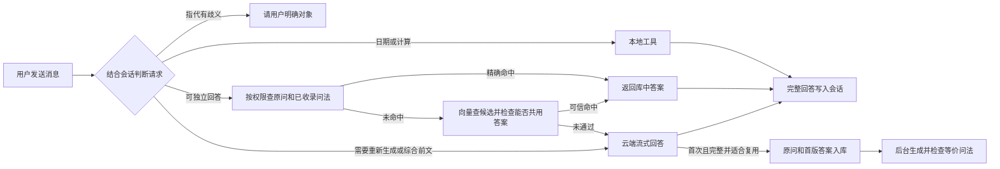
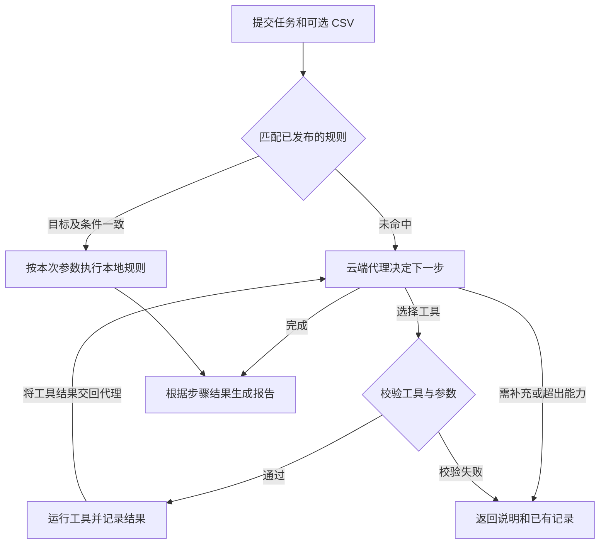

# 柒柿AI · 黑客松技术方案

首版采用 **React + TypeScript + Vite、Python + FastAPI、SQLite**。浏览器提供聊天、问答库和 Work 工作台，所有请求由同一个 FastAPI 服务处理。已知问答由 CPU 匹配和读取，新问题交给云端模型。Work 可重跑本地规则，也可由云端代理根据每一步的结果继续调用内置工具。[产品设计文档](./柒柿AI黑客松产品设计.md)

## 技术选型与部署

| 模块 | 选型 | 用途 |

| --- | --- | --- |

| Web | React、TypeScript、Vite | 聊天历史、Markdown 和代码块、复制与重试、答案来源、问答库管理。 |

| API | Python、FastAPI、Uvicorn | 会话管理、回答路由、用量统计和 Work 任务执行。聊天消息通过 SSE 返回，Work 返回结构化步骤与结果。 |

| 存储 | SQLite，启用 WAL 和外键 | 保存会话、问答、改写、共享库成员关系、任务和用量。 |

| 本地匹配 | `bge-small-zh-v1.5`、NumPy、轻量中文句对模型 | BGE 生成向量，NumPy 在内存中计算相似度。句对模型检查候选是否能共用答案，型号和阈值由演示机实测确定。 |

| 云端 | 一个可配置的模型 API | 流式生成新答案，并在后台生成问法。服务端配置 API 地址、密钥、模型名和超时。 |

演示版将 Vite 构建产物交给 FastAPI 同源托管，在普通 CPU 电脑上启动一个服务进程。启动前把模型文件下载到本地，运行时从本地路径加载。SQLite 文件保存在持久目录。CPU 推理放到有并发上限的工作线程，避免堵住聊天流和精确查询。公开试用可沿用同一套应用，部署到 CPU 服务器。

## 首版身份与权限

部署者用本地管理命令创建演示账号、设置登录凭据，并授予指定用户某个共享库的管理员角色。登录验证凭据成功后，服务端用持久化的服务端密钥签发短期 token，包含用户标识 `sub`、到期时间和会话标识。浏览器通过同源 HttpOnly、SameSite cookie 携带 token，HTTPS 部署启用 Secure，修改操作校验请求来源或 CSRF 凭据。

FastAPI 路由统一注入 `Depends(current_user)`。该依赖按固定签名算法验签、检查到期时间，并查询用户和登录会话的有效状态。服务端根据已验证的用户标识、记录所有者和当前库成员关系决定读取、反馈或管理权限。客户端提交的库标识只能选择目标资源。查询层在检索前限定作用域，精确查找、向量候选、详情、聊天历史及管理操作均使用此约束。令牌无效返回 401，权限不足拒绝操作。撤销成员关系后下一次请求即按新权限执行。

演示凭据一人一份。游客反馈进入审核队列，预置或正式验证的成员账号可参与共享暂停投票。公开试用增加注册或第三方登录时，沿用内部用户标识、`current_user` 和库成员授权。会话 cookie 也可以只存服务端生成的随机会话标识，由服务端查表认证。本项目选用签名 token 以明确凭证和请求依赖的约定。

## 一条消息怎么回答

1. **先理解当前会话。** 默认读取同一聊天最近 3 轮问答，并限制发给云端的上下文长度。规则优先从上一条回答的明确列表或当前讨论的选项组解析「这两个」「第二个」，沿用预算、设备等条件，以用户最新纠正为准。补全后仍有歧义就追问。需要综合分析前文时，将当前问题和相关消息交给云端。新聊天从空白上下文开始。

2. **分派工具与知识查询。** 日期、星期按请求的 IANA 时区读取系统时钟，时区缺失采用已设置的用户时区或先确认。简单算术用本地计算器。查库先限定可访问、当前发布、符合时效条件的记录，再查原问和等价问法。保留代码、数值、否定和语言等条件。个性化生成、依赖附件或主动重新问云端的请求走云端。外部实时值须有可核对的数据源。

3. **精确查不到时用本地模型。** 为独立问题生成向量，在可见记录的原问、改写和标准化意图中找少量候选，并按问答组去重。向量用于找候选。先用规则排除对象、数值、版本、否定、代码输入和输出要求等冲突，再用句对模型判断任务和适用条件是否足以共用答案。匹配到单一问题组后，按当前事实版本和请求风格选择可用表达。分数不足、条件不明或多个候选组的结论冲突时走云端或请用户补充。

4. **保存用户看到的答案。** 云端结果逐段发给前端，库中答案直接返回。两者都在会话里保存用户当时看到的文本以及来源。云端超时或断开时，保留失败状态和重试入口，完整回答才进入学习流程。云端不可用时，精确查询和本地语义匹配仍可回答已有问题。

本地工具、数据源、精确命中、语义命中和云端生成各有独立的来源标识。SSE 流发送文本片段、完成信息或失败信息。完成信息包含消息标识、来源、在线请求的云端调用次数、首次出字耗时和总耗时，供前端显示。

## 问答库与后台学习

| 数据 | 主要内容 |

| --- | --- |

| 会话与消息 | 所属身份、共享学习设置、完整消息、回答来源、生成状态，以及实际呈现的问题组、版本、匹配问法和变体标识。 |

| 问答组 | 原问、意图、适用条件、作用域、当前发布版本、时效策略、来源版本和下次复核时间。 |

| 答案版本与表达 | 每版保存事实结论、适用条件、依据、状态和默认表达。变体关联同一版本，记录风格、文本和发布状态。 |

| 反馈与审核 | 用户、实际看到的消息、库、反馈类型、目标版本或匹配关系、时间、处理结果。发布、恢复和停用记录操作者与依据。 |

| 等价问法 | 原问和改写的精确查询键、所属问答组、向量及向量模型版本。标准化意图的向量也可用于召回。 |

| 身份与共享库 | 用户、登录会话、共享库、成员关系及库内角色。演示账号和正式账号使用同一授权入口。 |

| 学习任务与用量 | 问答组标识、任务状态和重试记录，以及每次模型调用的用途、耗时、用量和费用。 |

- 普通会话的合格问答默认进入个人库。开启共享学习后，稳定或有明确来源版本、获准共享且能独立理解的问答可进入共享库。私人语境留在原会话。

- 首次合格回答在同一 SQLite 事务中创建组、初始发布版本、默认表达、原问查询键及学习任务。工作人员可追溯初始生成模型。后台任务生成 3–5 条候选改写，结构化解析、去重与条件检查通过后关联到组并更新向量。真实问法通过等价检查后也可入组。

- 每个问答组只建立一条学习任务。后台重启后继续处理待执行或领取超时的任务，优先检查已保存的结果，限制失败重试次数，并用唯一约束防止改写重复入库。调用云端期间保留任务状态，实际发生的重试计入用量。

- 主动重答、因报告暂停而产生的云端回答带上原目标和原因，跳过首次自动入库流程。优先保存到当前会话。本人采用或向共享库提交修订时再建草稿，重复提交按消息去重。发布事实修订时在同一事务比较基准版本、切换当前版本并停用旧版表达。并发修订基准过期则交由审核人复核。回滚留痕。已发送消息保留文本快照。

- 「换个说法」只从当前版本已发布且满足所需风格的变体中选择。个人库所有者、共享库管理员分别核对本库候选变体后发布。事实有分歧的候选进入事实修订流程。适用条件改动须重验关联问法和向量。

- 报告必须引用本人收到的消息，从该消息取实际返回的版本、问法和库。错配用「规范化的输入问法、问题组、匹配修订号」定位，包括尚未收录的语义命中。事实错误按「问题组、事实版本」定位。先为报告人绕开对应结果，再在一个事务内统计近 7 天同一目标不同已验证成员的有效报告。达到默认 3 人时记为暂停并入审核队列。对相同目标、用户和审核轮次去重。风格反馈单独记录。管理员恢复后开启新审核轮次，原轮次报告留痕。读取时复查当前状态，语义和精确查找都执行暂停检查，命中受影响目标的请求转云端。在共享库内，修订发布与恢复由该库管理员执行。

- 稳定事实允许复核时间为空。有版本的来源按版本建键，查询「当前」时按来源变更或复核时间判定可用性。到期仅在再次有请求时从权威来源核对，同一来源版本只允许一个在途刷新任务。内容未变只更新核验时间，发生变化且影响事实时提交候选修订，审核前提示暂无法确认或直接展示可验证的数据源结果。无数据源时说明当前值未知。工具算出的星期与天气这类实时值只写入会话记录，问答库可复用对应的工具路由。外部数据缓存由地点、时间及来源新鲜度决定。

## Work 任务规划与执行

Work 通过独立入口运行任务，沿用现有登录、模型配置、云端额度与用量记录。浏览器提交一次 HTTP 请求，服务端在请求内执行本地规则或驱动云端代理。页面等待期间显示运行状态，返回后展示步骤与报告。

| 模块 | 首版设计 |
| --- | --- |
| 请求入口 | `POST /api/work/run` 复用现有登录和请求来源校验。输入自然语言目标及可选的一份 CSV。建议上限为目标 1,200 字符、CSV 正文 500 KB。 |
| 已发布的规则 | 预置「活动筹备简报」和「活动支出简报」。每条规则定义匹配条件、参数提取、工具顺序、依赖及结果口径。首版用完整语句模式匹配已知任务，允许数字、日期、列名和有限的措辞变化。匹配到多个规则或口径不明确时，不直接套用。提取本次输入，保留原始列名用于表头匹配。 |
| 云端代理 | 规则未命中时选用已启用的云端模型。模型读取任务目标、是否附有 CSV、工具定义及已执行的工具结果，逐步选择工具、请求澄清或结束任务。预算、日期和 CSV 合计均由服务端工具计算。 |
| 校验与执行 | 复用预算余额、日期间隔和 CSV 汇总函数。校验工具、必填参数、类型、范围和引用关系。最多运行四步，引用只读取此前成功步骤的已声明结果。工具失败后保留执行记录。 |
| 结果与记录 | 返回运行来源、实际云端调用次数、每步状态和输出，并据此生成 Markdown 报告。用量记录保存路径、耗时、成功状态和模型用量。上传内容和报告仅用于当次运行，Work 的执行记录与问答库独立。 |

成功执行的固定步骤可保存为账号私有规则。保存前由用户核对工具顺序、前序结果引用和可填写参数。新运行沿用步骤和引用，并读取本次参数和附件。涉及条件分支或失败后改用其他步骤的任务继续交给代理。服务器只持久化用户确认的规则，不保存原始任务文本、附件或计算结果。

每个工具步骤包含 `tool` 和 `inputs`。`inputs` 可以引用此前的工具结果。例如先调用 `csv` 汇总「金额」列，再调用 `budget` 时，总预算填 `1500`，已支出用 `{{1:总和}}` 引用汇总结果。若任务要求根据合计判断后续动作，代理收到合计后再选择是否调用 `budget`。缺少必填信息时由用户补充后重新提交。只有预先注册的工具可以执行。

每次发起云端请求时扣减额度，失败的尝试也计入实际用量。模型不可用、额度用尽或动作校验失败时，返回具体错误。出现中途失败时，保留已有执行记录和可下载的部分报告。任务输入、CSV 正文和报告正文仅参与当次运行。

## 开发顺序与验收

1. **打通聊天。** 接入签发与验证 token、`current_user` 和所有者或成员权限检查。完成聊天页、会话持久化、云端流式回答和重试。验证重启能恢复历史，「这两个哪个好」「第二个呢」能沿用原顺序以及预算和设备条件，新聊天里的同一句话会要求补充所指对象。上一条回答分别从云端和问答库产生时都要覆盖。

2. **打通学习与共享。** 从空库提问，验证完整回答后原问可精确命中，随后后台生成的改写能跨重启保存。第二个演示身份可以在同一共享库命中，且查不到另一身份的个人问答。确认问答纠正、停用和过期能影响后续查询。

3. **验证未收录问法。** 用多主题样本和易混淆反例校准模型阈值，并用独立用例和固定问答库快照验收。演示时确认「Python 3 的 `if` 条件遇到空列表时会判断为真还是假」尚未作为改写入库，再验证它能复用 `bool([])` 的答案。将输入改为 `bool([0])` 或要求英文输出时，应走云端。演示用例要求零误复用，并记录样本数。

4. **验证 CPU 与成本。** 在演示机上记录 CPU、内存、系统、语义匹配耗时和模型内存。关闭 GPU 加速和云端 API 后，验证网页、已收录问法和未收录等价问法的本地回答。恢复云端后验证未知问题可继续回答。用同一批留出的问法对比全走云端、只复用原问、复用原问加已收录改写、再加入语义匹配这四种配置。

5. **验证治理与授权。** 用预置的 3 个独立普通成员和 1 个库管理员验收。重复报告和窗口外报告不凑票，第 3 个有效成员触发暂停。验证误匹配只停相关问法，发布新版同时退出旧变体。普通成员不能发布或跨库管理，无效凭证不能读取私有记录，撤销成员后精确与语义查询都失去可见性。验证主动重答不会改共享答案，到期数据的并发请求只进行一次核对，跨时区或午夜的星期查询不调用云端。

聊天核心指标为 **正确且零云端调用的回答数 ÷ 聊天请求数**，同时记录 **误复用数 ÷ 复用次数**、正确率、首次出字和总耗时。每百次请求的 API 成本计入前台回答与后台改写、重试和更新。语义阈值、性能数据和成本节省幅度都由演示机及实际模型的测试结果填写。

### Work 验收与提交流程

| 验收项 | 检查方式 |
| --- | --- |
| 规则重跑 | 同一任务使用两份 CSV，预期支出总额分别是 638.50、700 元。总预算 1,500 元时，核对报告余额 861.50、800 元。核对两次的规则路径与 0 次云端调用。 |
| 未命中规则 | 载入「条件预算」示例，分别用合计为 638.50 元和 350 元的 CSV 运行同一目标。核对代理收到汇总结果后，第一份继续计算余额，第二份直接结束。 |
| 异常处理 | 输入缺列的 CSV，核对汇总失败、依赖该数值的预算步骤跳过。检查模型返回未知工具或无效引用时拒绝执行。停用云端模型后运行本地示例，确认结果正确。 |
| 用量与附件 | 核对 Work 路径、完成状态和实际云端调用次数。核对模型收到任务文字、附件存在标记和供决策使用的工具结果，CSV 正文只传给服务端汇总工具。 |
| 提交检查 | 从提交用的目录重新启动，验证登录、聊天的跨账号复用、Work 两条路径和报告下载。用同样的数据录制演示。 |

建议先复用现有工具、鉴权和用量接口，再接任务规则与云端代理，最后核对 Work 页面与报告。以 10 小时的提交窗口估算，可安排 4 小时接入、2 小时验收与修复、1 小时录屏、3 小时打包和提交缓冲。以实际验收结果决定演示范围。
