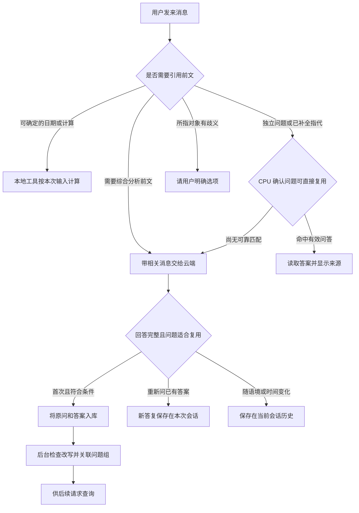

# 柒柿AI · 通用 AI 助手产品设计

## 产品目标

柒柿AI是一个面向普通人的通用聊天助手。用户打开网页就能用自然语言提问。系统记得已经回答过的通用问题，遇到等价问法时直接给出答案。首次遇到的问题交给云端强模型，模型完成回答后，系统在后台生成几条意思相同的问法，归入同一条问答记录。以后有更多用户问到同类问题，就可以分摊首次调用的成本。对于需要连续调用工具的任务，Work 可复用执行规则，按每次的输入重新计算。

首版支持中文文本聊天，题目可以来自软件操作、日常知识、学习、写作等不同场景。用户可以用「这两个」「第二个」等表达追问刚才的回答。系统先补全所指的对象和相关条件，再判断能否复用已有答案。写作与需要重新分析的问题可以交给云端。日期、星期和简单算术直接由本地工具计算。

## 黑客松首版

| 功能 | 用户体验与交付标准 |

| --- | --- |

| 日常聊天 | 左边是新建聊天和历史会话，中间显示对话，底部输入问题。云端答案流式显示，支持 Markdown、代码块、复制和重试。用户可以接着追问。 |

| 会话内记忆 | 记住当前聊天里最近几轮的用户要求和机器人答复。「这两个哪个好？」引用刚才的两个方案，并沿用预算、设备等相关条件。指代有歧义时，追问具体选项。 |

| 按意图复用已知答案 | 应用先查原问题和已记录的问法，再用本地语义模型查找意思相同的候选。确认用户要解决的问题、对象和条件一致后，CPU 直接读取答案，在线请求的云端调用次数为 0。 |

| 新问题问云端 | 未命中或需要综合前文时，把当前问题和相关的近期消息交给一个可配置的云端模型。用户也可以点「重新问云端」主动拿新答案。 |

| 回答后自动学习 | 完成一次云端回答后，保存符合复用条件的原问和答案。后台为这条问答提取意图和适用条件，再生成 3–5 个候选等价问法，通过检查的问法都指向同一组问题。成功复用的真实问法也可以进入同一个问题组。 |

| 个人与共享问答库 | 普通会话产生的可复用记录默认存到个人库。选择共享学习的会话可贡献通用问答，同一共享库内的用户可以复用。演示用两个独立身份加入同一个测试库。 |

| 回答来源和纠错 | 用户可点开查看答案来自问答库还是本次云端生成，并报告答错。规则与问答库页面可查看原问、改写、更新时间和命中次数，个人库由本人更正或停用，共享库由该库管理员处理。 |

| 云端用量 | 演示模式显示本次调用次数、首次出字耗时和总耗时。用量统计分别计入回答和后台生成问法的成本。 |
| Work 任务执行 | 输入目标，系统拆解任务并依次调用工具。已有规则按本次数据重跑，规则未覆盖的任务交给云端规划。查看步骤、云端调用次数，下载报告。 |

首版交付聊天页、问答库页和 Work 工作台。聊天演示在同一入口展示云端回答和本地问答复用，云端服务使用团队可调用的一个强模型，模型名称作为配置。聊天历史保存完整对话，学习库只保存获准复用的独立问答。黑客松可以在一台普通电脑上启动服务，通过浏览器使用。公开试用时可以把同一套服务部署在 CPU 服务器上，用户通过浏览器访问共享问答库。

## Work 工作台

Work 面向需要连续调用工具的任务。用户写下目标，可以附一份 CSV。系统为可复用的任务套用已有步骤，为规则未覆盖的任务调用云端模型规划步骤，再由服务端按顺序调用工具。页面展示规划来源、每一步的状态与结果、云端调用次数，并支持下载 Markdown 报告。

| 用户输入 | 系统行为 | 用户看到的结果 |
| --- | --- | --- |
| 同类任务换了金额、日期或文件，计算口径相同 | 匹配已发布的规则，提取本次参数，按相同步骤重算 | 显示本地规则和 0 次云端调用。报告取本次实际计算值。 |
| 任务目标或步骤组合未被规则覆盖，现有工具可以完成 | 云端模型规划一次，服务端校验计划后按顺序执行 | 显示云端规划和实际调用次数。结果取工具输出。 |
| 缺参数、缺附件，或同一输入可能有多个含义 | 明确指出用户需要补充什么，再由用户提交 | 保留已填内容。工具执行失败时显示原因，余下步骤标注跳过。 |
| 目标超出现有工具范围，或云端规划不可用 | 说明当前支持的范围或失败原因，提供可运行的本地示例 | 用户仍可运行满足本地规则的任务。 |

首版支持预算余额、日期间隔和 CSV 数值列汇总。活动支出场景由「汇总本次 CSV 的金额」和「用本次合计得出预算余额」组成。总预算 1,500 元时，第一份 CSV 合计 638.50 元，余额 861.50 元。换成合计 700 元的 CSV，结果变为 800 元。两次复用同一套步骤，各调用云端 0 次。

同类任务要求目标、计算口径和步骤依赖一致。用另一份表汇总同一列可以重跑规则。把求和改为求平均值就改变了计算口径，需要重新判断工具能否完成。每次运行最多四步，限用上述三种内置工具。CSV 正文由服务端处理，云端规划只接收任务文字和是否附有 CSV。报告由用户自行下载。

## 从新问题到可复用答案

- **怎样生成等价问法。** 云端模型根据原问题和答复生成改写，并标出适用前提。系统去掉重复和空白改写，检查数字、关键代码片段等可比较字段，拒收改变原条件的条目。等价性拿不准时，当前答复仍保留在会话中，换个问法再遇到时可以继续问云端。

- **怎样保存与更新。** 等价问法关联到问题组。组内记录适用条件、当前事实版本及可选的简短、详细等表达。事实修订发布后，所有问法读取新版本，历史聊天仍能看到当时的答复。

- **哪些问答能共享。** 共享学习只收录获准共享、能独立理解且有稳定答案或明确来源的通用知识。私人上下文保存在原会话。实时数据根据来源和时效要求单独处理。

一次云端回答成功结束后，用户马上能看到完整答案。符合条件的原问可直接复用。后台完成检查后，新问法也能用于查询。网络中断或云端额度耗尽时，已有的可用问答仍能直接返回，未命中的问题在会话中保留重试入口。

## 答案更新、纠错与复用策略（首版建议）

**重新问云端。** 点击后，本轮绕开问答库，用户可对比新旧答案。云端失败时保留原答和重试入口。个人库的所有者可点「采用为新版本」。共享库成员可点「建议修订」，管理员核对依据后发布、保留原版或收为风格变体。重新生成本身不计误答票。涉及个人上下文的新答案仅保存在会话中。

**报告误答。** 用户可以选「事实有误」「答非所问」或「表达不合适」。事实报告针对事实版本，错配报告针对本次问法与问题组的匹配关系，风格反馈用于切换表达。前两类反馈从第一条起就让报告人下次绕开对应结果，并可当场重新问云端。共享库的建议默认值是滚动 7 天内，3 个实际收到该结果的不同已验证成员报告同一对象，即临时暂停该版本或匹配关系。重复提交只算 1 人，游客反馈可供审核。暂停后，相应请求交给云端，直到管理员核查后恢复、修正或停用。明确的错误可由管理员在第一条报告时处理。阈值由项目维护者配置，公开试用时用误停率、处理时间及额外调用成本校准。

**谁可以管理。** 个人库由本人管理。共享库普通成员可使用、反馈和建议修订，每个共享库由指定管理员发布修订、停用和回滚。首版由部署者在服务端给指定账号授予库管理员角色。这个角色的权限只覆盖所在共享库。演示身份也使用服务端签发的凭证，个人注册流程可以随后接入。

| 问题或事实 | 首版怎么回答 | 何时付出更新成本 |

| --- | --- | --- |

| 稳定事实，如空列表的布尔值 | 记录适用语言版本，长期复用 | 有纠错或条件改变时复核，无日历到期任务。 |

| 会变的资料，如软件当前价格、政策 | 固定版本按版本检索。「当前」类答案记录可核对的来源、适用范围和复核时间 | 来源更新可使旧答失效。到期后等下一次有人问再核对，同一来源版本的并发核对合并一次。缺少可验证的新来源时提示暂无法确认当前值。 |

| 可直接计算，如今天星期几 | 根据用户时区读取系统时钟，算出当时的日期和星期 | 每次本地计算，云端调用为 0。跨午夜或切换时区会取到正确的新结果。 |

| 高频变化的外部事实，如天气 | 接入数据源后按地点、观测时间和来源给出的有效时段复用 | 需要新值时查数据源。首版无对应数据源时说明无法确认实时情况。 |

**同一题的多种答案。** 一个已发布的事实版本可以关联「简短」「详细」「举例」等多种合格答法。默认显示标准答法，用户点「换个说法」优先读已有变体，零云端调用。库里没有所选风格时，用户仍可主动重新问云端。只有结论、适用条件和时效都一致的答法才能作为同版变体。结论冲突的内容进入修订审核。两种做法都可行但各有前提时，在答案中并列说明适用场景。更正事实时，旧版的全部表达一起退出匹配。

## 会话内记忆

首版使用当前聊天的最近 3 轮问答作为默认范围，同时限制传给云端的上下文长度。历史保存在已有的 SQLite 会话记录里。来自问答库和云端的答案都按用户当时看到的内容写入会话，以便用户重新打开这个聊天继续追问。新建聊天从空白上下文开始。

1. 用户说「这两个」或「第二个」时，先用本地规则查找上一条答复中明确列出的候选方案，或沿用正在讨论的选项组。按首次列出的顺序定位，并补上会影响这次比较的预算、设备或其他要求。用户刚纠正的条件优先采用。

2. 引用明确且补全后的问题可以独立回答时，先尝试本地问答匹配。例如把「这两个哪个好？」补全为「对于预算有限且没有独显的用户，CPU 查库加云端回答与 GPU 本地运行小模型，哪个更适合起步？」。没有适用答案时，用一次云端请求发送当前问题和相关前文，完成比较和回答。

3. 如果有多组都可能是用户指的对象，或者当前聊天里找不到指代对象，先问「你指的是哪两个方案？」。用户补充对象后继续。依赖私人条件或对话语境的比较结果保留在该会话里。

例如，用户先说自己没有独显、希望少花钱。机器人给出「CPU 查库，复杂问题交给云端」和「用 RTX 5060 本地跑小模型」两个方案。用户接着问「这两个哪个好？」，回答就应明确点出这两个方案，并根据用户已有设备和启动成本给出建议。用户继续问「第二个呢？」，系统沿用原来列表里的第二项。

## CPU 如何判断意图相同

系统为每个可复用问题记录用户想得到什么、问题涉及的对象，以及会改变答案的前提和答复要求。例如「解释 Python 3 中空列表的布尔值」可以同时匹配包含 `bool([])` 的问法和描述 `if` 条件判断的问法。这里的意图来自每组问答，系统可以随着新问题扩展到其他主题。

1. **先查精确命中。** 使用原问题，或已补齐对象与必要条件的追问，在当前用户可访问的有效记录中查找。依赖更长前文或附件、难以独立理解的问题交给云端结合上下文回答。

2. **再检索意思相近的候选。** 如果精确查找无结果，用本地中文向量模型把提问转成向量，从原问、等价问法和标准化意图中找出最接近的少量候选。首版在 CPU 上处理小型问答库。

3. **逐条判断能否复用。** 先用规则识别可以确定的冲突，如对象、数值、版本、否定、代码输入、语言和输出格式。再用本地轻量文本匹配模型对比新问题和候选，判断用户要求的任务、语义条件和答复范围能否由同一个答案满足。向量分数用于检索，最终结果根据条件检查与文本匹配共同决定。

4. **有把握才返回。** 一个问题组通过检查时，按所需表达选择该组当前版本的答案。条件有冲突、信息不足或多个候选指向不同答案时，按需追问或走云端。文本匹配分数的门槛用多主题例子校准，优先控制误用。

| 已记录的原问题 | 新问法 | 系统应做什么 |

| --- | --- | --- |

| Python 3 的 `bool([])` 返回什么？为什么？ | Python 3 的 `if` 条件遇到空列表时会判断为真还是假？原因是什么？ | 任务和对象等价，即使问法从未收录，也可复用。 |

| 同上 | 那 `bool([0])` 呢？ | 需要用到前文，而且输入变成非空列表，带着上下文走云端。 |

| 同上 | 用英语解释 Python 3 的 `bool([])` 为什么为假。 | 输出语言发生变化，已有中文答案无法满足请求，走云端。 |

## CPU 与 RTX 5060 路线

| 部署方式 | 本机负责什么 | 适用阶段 |

| --- | --- | --- |

| 普通 CPU 电脑 | 网页、聊天历史、SQLite 问答库、原问和别名索引、匹配和读答案。首次问题及改写由云端 API 完成。 | 黑客松默认部署，已知问答在断开云端连接时也能运行。新问题依赖联网与 API 额度。 |

| CPU 加轻量语义模型 | 在本机生成向量、查找候选，再对少量文本做等价性判断。模型随服务部署后，这条路径可以离线运行。 | 黑客松验证从未入库的等价问法。用实际测试机记录模型内存、语义匹配的延迟和误命中。 |

| 可选 RTX 5060 | 运行本地量化小模型，尝试处理意图判断、改写和部分简单新问题。复杂问题仍可交给云端强模型。 | 后续增强，按实际显存、上下文长度和速度选模型。对照 CPU 加云端方案，测本地收益和质量变化。 |

首版把「普通 CPU 运行」落实为一项验收。关闭 GPU 加速并关闭云端 API 后，已有问答仍能打开网页、检索和回答。未知问题恢复联网后可以继续用强模型。文档中的延迟、并发和费用指标均需要用实测数据填写。

## 三分钟主线演示

1. 用户 A 在一条新会话里问「Python 3 的 `bool([])` 返回什么？为什么？」。屏幕显示云端答复为 `False`，并解释空列表在布尔判断中为假。

2. 打开问答库，展示系统刚生成的多种问法。例如「在 Python 3 中，`bool([])` 的结果和原因是什么？」。实际演示使用当场生成并入库的表达。

3. 换用户 B，在独立会话里用其中一种改写提问，再问一句库里没有的自然改写，例如表格中的 `if` 问法。回答详情分别显示已收录的问法命中和语义匹配命中，两次调用云端均为 0。演示前检查后一条问法确实未入库。

4. 用户 B 把输入改成 `bool([0])`。云端解释非空列表的布尔值为 `True`。

5. 换一条聊天，用户说「我没有独显，预算也有限。给我两个运行 AI 助手的方案」。看到答复后只输入「这两个哪个好？」。机器人点出刚给过的两个方案，根据预算和设备比较。也可以在测试时从问答库返回上一条方案答复，验证追问走同一个会话流程。

### Work 演示（约 45 秒，可接在主线之后）

1. 打开 Work，输入「帮我做活动支出简报：总预算1500元，用CSV的「金额」列汇总支出，再算预算余额。」第一份 CSV 的「金额」列填 400.25、238.25。展示两步结果 638.50 元、861.50 元，以及「本地规则」和 0 次云端调用。
2. 换成「金额」列为 400、300 的 CSV，重跑同一任务。展示 800 元余额并下载报告。
3. 输入「先算 2026-12-01 到 2026-12-05 的日期间隔，再用总预算 900 元和已支出 180 元算余额」。检查云端调用 1 次，工具按顺序返回 4 天、720 元。

## 如何验收和计算成本

| 验收项 | 检查方式 |

| --- | --- |

| 学习闭环 | 从空库开始，验证首次提问走云端、自动生成改写并持久化、重启后改写仍可复用，且另一身份可在同一共享库命中。检查个人库的问答不会出现在另一身份的匹配结果里。 |

| 匹配准确 | 准备来自多个主题的独立问题、未写入库的自然改写和容易误命中的反例。分别验证原问、已收录改写、未收录改写和不等价提问。用独立用例校准门槛，最终计分时固定问答库快照。演示用例中错误复用为 0，并记录测试样本量。 |

| 更新和治理 | 验证重新问云端后双方看到的答案、个人采用与共享发布的范围、报告去重与暂停、变体随事实版本失效。按用户时区跨午夜问星期，检查结果和云端调用数；反复提问稳定事实，检查没有周期性刷新费用。 |

| 多轮追问 | 上一条答复分别由问答库和云端生成，随后发「这两个哪个好？」和「第二个呢？」。核对是否找到原方案并保留用户已经给出的条件。在新聊天里直接问同一句时应请求补充对象。在原聊天内遇到相近但不适用的比较答案时应重新分析。 |

| 低配置 | 记录测试电脑的 CPU、内存和系统。以 CPU 模式跑通普通聊天和已知路径，并在云端不可用时验证已知问题仍可回答。 |

| 费用与速度 | 用同一批留出的问法比较四种配置。每次走云端，仅复用原问，复用原问和已收录改写，以及再加入意图匹配。记录正确率、云端调用次数、首次出字与完成时间、每百次请求的总 API 成本。把后台改写、重试和更新计入费用。 |

聊天的核心指标是「正确且零云端调用的回答数 / 聊天请求数」。同时看「误复用数 / 复用次数」。这样可以判断自动增加的问法是否扩大了覆盖范围，以及节约的费用能否抵消生成改写的开销。

Work 单独记录成功完成数、正确且零云端调用的任务数、任务总数和平均云端调用次数。成功需要工具结果正确、步骤顺序和依赖符合任务要求、报告与结果一致。验收涵盖更换文件、云端规划、缺参数及中途失败。

## 后续路线

| 阶段 | 要加入的能力 | 进入下一阶段的依据 |

| --- | --- | --- |

| 黑客松首版 | 通用文本聊天、会话内记忆、云端模型、等价问法学习、本地匹配、问答库、用量统计和 Work。 | 验收跨账号问答复用、多轮追问、Work 本地规则重跑与云端规划。 |

| 公开试用 | 开放账号注册、跨设备会话、费用额度和外部数据源接入。依据真实报告校准暂停阈值和复核间隔。扩大本地语义检索覆盖，按真实问法校准复用条件。 | 在真实流量回放中，正确且零云端调用的比例提升，将误用与实际 API 账单纳入评估。 |

| 完善通用助手 | 网页搜索和引用、文件问答、图片理解、语音输入。加入长对话摘要、可主动开启的跨会话个人记忆、共享知识库、不同云端模型的选择和路由。 | 逐项验证来源可追溯、上下文处理和费用，并分别看各能力的真实使用量。 |

| 扩充 Work 与本地模型 | 增加经审核的任务规则和工具。支持将验证过的任务计划保存为可填参数的规则。可在 RTX 5060 上尝试小模型，验证本地规划。 | 用新的文件、参数和易混淆任务验证规则适用范围，再实测本地规划的正确率、延迟和内存。 |

先让聊天页打通云端回答和会话内追问，再做精确查找、自动改写和独立会话复用。接入本地语义检索与等价检查后，用同一批提问评估额外的正确命中、运行开销和云端成本。

